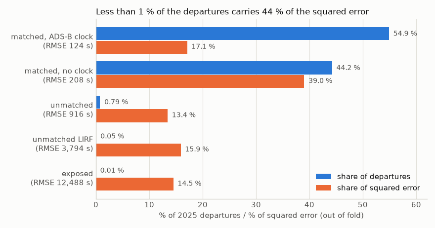
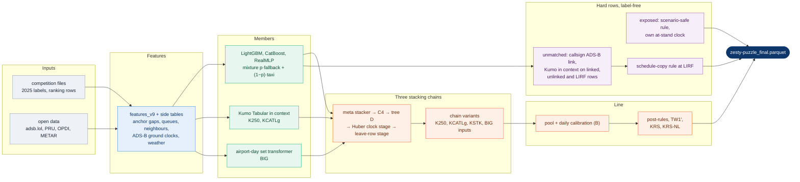
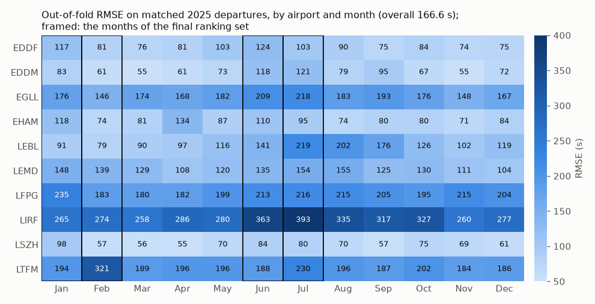

# zesty-puzzle: taxi-out time prediction, PRC Data Challenge 2026

Code of team zesty-puzzle for the EUROCONTROL Performance Review Commission / OpenSky Network Data Challenge 2026. The task is to predict
the taxi-out time (`MVT_TIME − BLOCK_TIME`, seconds) of every departure at ten European airports (EDDF, EDDM, EGLL, EHAM, LEBL, LEMD,
LFPG, LIRF, LSZH, LTFM), scored by RMSE. The model is trained on the 2,085,047 departures of 2025. It predicts the residual to the Network
Manager's off-block clock with gradient-boosting, neural and foundation-model members, stacks them in three chains, and prices the 1.08 %
of departures without a flight-plan match (22,424) by label-free rules. On the public leaderboard (the January and July 2026 rows) the submitted pipeline
scores **221.46 s**. The final file covers January, February, June and July 2026 (670,790 departures); the organisers rank it on February and
June, the two months that were never on a leaderboard, and compare with January/July and all four months. No competition data, predictions or trained models are included in this repository. The repository is a curated
release of a private research repository; its commit history covers a single day by design.

**Contents:** [How it works](#how-it-works) · [Results](#results) · [Hardware and runtime](#hardware-and-runtime) ·
[About the reproducibility of the results](#about-the-reproducibility-of-the-results) · [How to run](#how-to-run) ·
[Repository layout](#repository-layout) · [Data sources and licences](#data-sources-and-licences) · [Citation, licence and author](#citation-licence-and-author)

## How it works

### 1. The problem, and why it is hard
Taxi-out time is the gap between two clocks written by different systems: the airport's block time (`BLOCK_TIME`, the aircraft leaves
the stand) and the movement time (`MVT_TIME`, take-off). The 1,142,270 matched 2025 departures with an ADS-B ground clock (55 % of the
rows) reach 124 s out-of-fold RMSE and carry 17 % of the squared error. The other 83 % comes from unmatched rows (44 %) and matched rows without a clock (39 %):

- **The error sits in a small share of the rows.** Departures without a flight-plan match are 1.08 % of 2025 (22,424); the 17,569 of
  them outside the sealed days are 0.85 % of the scored rows and carry 44 % of the squared error of the out-of-fold predictions (figure). Labels over two hours are 0.03 % of the rows and carry 46 % of the
  squared deviation.
- **Many large labels are recording artefacts, not long taxis.** The block column then holds a fallback value: the scheduled time copied
  into the block field, or a clock on the wrong date. These rows are scored as exported (organiser statement), so they are modelled, not
  filtered. At LIRF, 26 of the 28 unmatched 2025 departures that a real off-block time would have joined to their flight plan carry
  exactly the scheduled time as block time.
- **Matched rows: 124 s RMSE with the aircraft's own ADS-B ground clock, 208 s without it.** The 920,353 matched rows without a trace
  (44.6 % of the 2,062,623 matched rows) carry 39 % of the out-of-fold squared error.



*2025 departures by row type. Matched: the flight-plan join exists (split by whether the airframe has an adsb.lol ground trace).
Unmatched: no flight-plan match. Exposed: no match and take-off more than 8 h after the schedule. Out-of-fold predictions; the 4,855 unmatched rows on sealed
airport-days are not scored here, so the figure covers 2,080,192 of the 2,085,047 departures; aggregates
from [`docs/figures/row_types_2025.json`](docs/figures/row_types_2025.json).*

### 2. What the data gives us
- **An anchor.** The Network Manager's actual off-block time `AOBT_3` is a second, independent off-block clock. `MVT − AOBT_3` alone scores
  385 s on 2025, and every model predicts the residual `y − (MVT − AOBT_3)` rather than the taxi time itself.
- **The schedule and the flight plan.** Gaps between take-off and the scheduled, filed (`EOBT_1`, `LOBT`) and initial off-block times;
  pre-departure plan changes; aircraft, operator, stand and runway.
- **A third clock from open ADS-B data.** adsb.lol traces of the departure's own airframe show when it first moved, when it pushed back
  and where it held. Linked by callsign and take-off time; coverage is uneven (LTFM has none in 2026, LFPG 14 %, most airports 62–96 %).
- **The airport's state at that moment.** Runway queue, neighbouring departures and arrivals (forward and backward windows), stand
  occupancy and turnaround, a label-free delay regime of the day, flight memory over earlier days.
- **Open context.** EUROCONTROL's published daily pre-departure delay and ATFM indicators, OPDI milestones, hourly METAR weather.

The feature groups and their sources are listed in [`docs/METHOD.md` §2](docs/METHOD.md#2-features).

### 3. The model
Every gradient-boosting and neural member is a **mixture**: a classifier gives the probability `p` that the block stamp is a fallback
value, two regressors predict the ordinary taxi and the fallback value, and the output is `p·fallback + (1 − p)·taxi`. The members feed
three **stacking chains** that differ in the member family they read (LightGBM, CatBoost, RealMLP). Each chain runs the same stages: a
LightGBM meta stacker, a same-day neighbour correction, a tree step on its residual, a Huber stage on the ADS-B clocks, and a leave-row
stage. The three chains are pooled with fixed weights, calibrated per day to EUROCONTROL's published delay, and corrected by three
label-free post-rules (stand floor, late-off-block pull, LFPG return-to-stand twin rule).

NVIDIA's **Kumo Tabular**, a tabular foundation model used in context (open weights, run locally), enters in four places: as a member
whose context is the airport's whole 2025 pool (**K250**), as a variant with raw categorical columns and a log target (**KCATLg**), as a
second stacking engine on the chain stacker's own inputs (**KSTK**), and as a **re-step** (**KRS**, **KRS-NL**) that moves the line toward
K250 by an amount set by how much K250's instances agree. An airport-day **set transformer** (**BIG**) reads all departures of an airport
and day at once.



The members, chains and stages are specified in [`docs/METHOD.md` §3–§5](docs/METHOD.md#3-members); the short labels are listed in
[`docs/naming.md`](docs/naming.md).

### 4. Rules for the hard rows
The rows that carry most of the error are priced by rules that read no label of the ranking period. Each rule was fixed on 2025.

- **Schedule-copy rule at LIRF.** The organisers' flight-plan join pairs a block time with a flight only if `|BLOCK − LOBT| ≤ 3,600 s`.
  When an unmatched LIRF departure's flight-plan record can be recovered from the orphan arrival record of the same flight, the reason the
  join failed is readable: if the real off-block was more than an hour from `LOBT` (`|AOBT_3 − LOBT| > 3,600 s` on the recovered record),
  the stamp is real and the prediction is the Network Manager clock plus the airport's median offset; otherwise, if `|SCHED − LOBT| > 3,600 s`,
  a real off-block time would have joined, so the block field must hold the scheduled time and the prediction is `MVT − SCHED`; other rows
  are not priced. On 2025 the first case has the block equal to the schedule in 26 of 28 rows, the second in 0 of 100.
- **Label-free pricing of unmatched and exposed rows.** Unmatched departures are linked to their own adsb.lol trace by callsign
  (take-off within 60 s) and corrected on that clock; Kumo Tabular, used in context on the labelled 2025 rows of the same class, adds a
  clipped residual. Exposed rows move only where every label scenario agrees that the move cannot hurt (PX-safe) or where the aircraft's
  own at-stand clock is available (E1s). The bounds are exact binomial bounds on 2025 counts.
- **Tail guard for the log-target Kumo member.** A log target compresses the extreme tail. Where the raw-target member predicts more than
  2,400 s (0.93 % of the final rows), its prediction replaces the log-target one.

Details and the 2025 checks: [`docs/METHOD.md` §6](docs/METHOD.md#6-unmatched-and-exposed-rows-label-free-pricing).

### 5. Validation
Fitting uses the 2025 labels, label-free statistics over the ranking rows, EUROCONTROL's published daily PRU delay aggregates of the
scored days (daily calibration (B) and the `xpr` stacker inputs; no taxi-time label) and, for the pseudo-label member, the run's own first-pass
predictions on the ranking rows ([`docs/METHOD.md` §9](docs/METHOD.md#9-treatment-of-public-and-hidden-months)). No weight, clip,
threshold or other continuous parameter of the submitted line was set from a leaderboard score; five components and the combinations
of uploads 69, 85 and 91 were kept or rolled back on the public score (below, [`docs/METHOD.md` §7](docs/METHOD.md#7-validation)).

**Use of the public leaderboard.** The public leaderboard (January and July 2026) was used as a confirmation check of changes that had
passed the pre-declared 2025 validation gates below: the month-pair folds, the fresh folds and the sealed days. Every upload was a
complete model built by these scripts from 2025 fits. Five components of the submitted line did not pass every criterion of their
gate: E1s (the own at-stand clock rule for exposed rows), the wide-leaf twin, the pseudo-label member, KRS-NL (the non-linear Kumo
re-step) and KCAT8 (the Kumo member with 8 categorical columns, which KCATLg uses on the rows it predicts above 2,400 s). For them, for the parts of the combinations
of uploads 69, 85 and 91, and for dropping the day-of-year feature against the 2025 folds (14 September, before the fixed
gate), the decision to keep or roll back was taken on the public score of an isolated upload. Every upload
with the 2025 check that preceded it and its public score: [`docs/upload_log.md`](docs/upload_log.md).
How the public months (January, July) and the hidden months (February, June) are treated, and exactly where rows of the public
ranking file enter the computation: [`docs/METHOD.md` §9](docs/METHOD.md#9-treatment-of-public-and-hidden-months).

- **Month-pair folds.** Four gate folds, each a winter and a summer month like the test (3+9, 2+8, 4+10, 1+7), and two fresh folds (5+11,
  6+12, from 25 September) that were not used to choose between candidates of the matched-row line. Every stage is fitted nested, so
  its own fit leaves the scored fold out.
- **Sealed days.** 20 % of the airport-days (720 days) were drawn on 29 September with a fixed seed before any score on them and read
  once per candidate.
- **Gate for a change.** A gain on at least 3 of 4 gate folds that also holds without the three largest row contributions and after
  removing each airport-day's mean error; both fresh folds better; the sealed days confirm; better than a placebo with permuted inputs;
  a label-free 2026 drift check of every new input. Small classes (unmatched rows) use leave-one-month-out instead (at least 7 of 12
  held-out months better).
- **Gate results of the main components** (ΔMSE in s² on the 2025 fold rows, re-weighted to the ranking-set mix; the line with the
  component minus the line without it at the time of admission; full table with all components and verdicts:
  [`docs/METHOD.md` §7](docs/METHOD.md#7-validation)):

  | component | gate folds 3+9 / 2+8 / 4+10 / 1+7 | fresh 5+11 / 6+12 | sealed days |
  |---|---|---|---|
  | (B) daily calibration | −207 / −629 / −290 / −346 | not recorded | — |
  | three-chain pool | −192 / −266 / −240 / −142 | not recorded | — |
  | callsign ADS-B link of unmatched rows (half strength) | −114 / −185 / −75 / −197 | −119 / −139 (used for selection) | — |
  | K250 | −451 / −552 / −405 / −511 | −475 / −430 | not recorded |
  | KRS | −3 / −159 / −42 / −166 | −92 / −126 | 3/4 < 0 |
  | BIG | −9 / −31 / −57 / −210 | −135 / −83 | −81 |
  | KSTK | −67 / −27 / −41 / −42 | −28 / −16 | −103 |
  | KCATLg (vs KCAT8) | −35 / −33 / −42 / −69 | −56 / −16 | −58 |

- **Airport × month check.** The final line is scored per airport and month on the held-out months (figure), so that a gain in the
  average cannot hide a loss at one airport or in one season.



*Matched 2025 departures, each month scored by models that did not see it (chain line with KRS, before KRS-NL: overall 166.6 s; the final line
with KRS-NL: 166.5 s). The error tracks the share of departures that block out well before `AOBT_3`; at LTFM in February the snow days 19 and 23 Feb hold 6 % of the rows and
46 % of the squared error above the other months' level; LIRF in summer has little ADS-B coverage and many
scheduled-time stamps. Aggregates from [`docs/figures/airport_month_rmse_2025.json`](docs/figures/airport_month_rmse_2025.json).*

## Results
| set | departures | RMSE (s) |
|---|---|---|
| 2025, month-held-out validation of the final line (v111, with KRS-NL), matched rows | 2,062,623 | 166.5 |
| public leaderboard: the Jan + Jul rows of the submitted final file | 344,841 | **221.46** |
| final blind ranking, Jan + Feb + Jun + Jul 2026: the submitted final file (md5 `1a155e9f…`) | 670,790 | published by the organisers |

The 221.46 s is the public check of the submitted file (upload 115); before the upload its score was declared as 221.2 ± 0.6 s (1σ).
The earlier 221.16 s (upload 114) belongs to a variant that reused the predictions of earlier uploads for 5,283 January and July
unmatched rows; it was not submitted because that reuse applied to the public months only, while the submitted file prices the
unmatched rows of all four months with the same label-free rules.

## Hardware and runtime
Built on an ASUS Ascent GX10 (NVIDIA DGX Spark platform, GB10), an Apple M5 Max (64 GB), an AMD Ryzen 5 8500GE CPU node and, for additional
Kumo fold runs, an NVIDIA H100; 28 CatBoost seeds and the RealMLP and set-transformer production fits ran on 8 cloud RTX PRO 6000 GPUs. 64 GB of RAM
and one GPU with at least 16 GB are enough for every step (the Kumo staging peaks at about 25 GB). Machine table, per-step runtimes
(≈ 330 CPU-h + ≈ 20 GPU-h for the member fits, ≈ 15 h for the other stages of a production run): [`docs/REPRODUCE.md` §1–2](docs/REPRODUCE.md#1-hardware).

## About the reproducibility of the results
| tier | what | inputs | time | expected |
|---|---|---|---|---|
| 0 | `make test` (pytest on synthetic rows, ruff), CI `.github/workflows/ci.yml` | this repository | < 1 min | all tests pass |
| 1 | `make assemble STAGES=<dir>` (`scripts/assemble_final.sh`: line A = KCATLg line, line B = bag line) | the four stage files of `manifest/final_inputs.md5`, `data/final/final_ranking.parquet`, 2025 training files | ≈ 10 s, 4 threads | byte-exact: `1a155e9fc6e43cff09ca3b9f46b7cede`, `public_janjul` `9cd6296d…` (aarch64 and x86_64) |
| 2 | line runs from the saved chain outputs ([`REPRODUCE.md` §6c](docs/REPRODUCE.md#6c-stage-by-stage-md5-chain)) | saved `PR_*_HA0L` chain outputs, linked fold vectors, Kumo arm files, stage slots of the two line workspaces | hours on CPU (post line and lever steps, `REPRODUCE.md` §2) | byte-exact md5 of every intermediate, `final.v99` and `final.v111` |
| 3 | `scripts/run_final.sh final` from raw data | competition files, open data, A side | ≈ 330 CPU-h + ≈ 20 GPU-h members, ≈ 15 h other stages | statistically equivalent within the measured refit spread (below; `REPRODUCE.md` §7), not the submitted bytes |

The stage inputs of tiers 1 and 2 are derived from competition data and so are not published; they can be provided to the organisers on
request, with md5s in `manifest/final_inputs.md5`. Why two line runs and how they relate to the four-run staged build:
[`REPRODUCE.md` §6b](docs/REPRODUCE.md#6b-the-staged-assembly-of-the-build). No step reads an earlier submission.

- **From-scratch checks pass within seed noise.** Rebuilding the features from the raw files gives every column bit-equal (461 columns with the optional
  geometry table, which no final member reads); the side
  tables are equal up to float rounding (≤ 4·10⁻¹² s). Re-predicting the saved member seeds from their saved models gives bit-equal
  outputs (129 of 130 files; in the other, one row differs by 0.26 s). One-seed refits of eleven members differ from the saved seed
  by 0.20–0.78 times the spread between two saved seeds (correlation ≥ 0.996).
- **The Kumo GPU runs are bit-identical.** On the GX10, re-running 184 Kumo instances (KCAT8, KCATL, K250) reproduced every saved output
  exactly, and the tail-guard set was unchanged.
- **What cannot be byte-identical, and why.** A LightGBM refit with the same command and seed is a new draw of the recipe, and aarch64 and
  x86_64 build different trees. Kumo in fp16 moves by 0.4–1.3 s RMS per instance between GPU types. Multi-threaded float sums in two polars
  group-bys move 1,106 rows on two days by up to ±3 s. One member (`lgb_adsb_linked_a`) shifts its LTFM level by −17 to −24 s when
  refitted on the final-period feature tables. A rebuild from scratch is therefore statistically equivalent to the submitted file, not identical
  ([`docs/known_issues.md`](docs/known_issues.md)).
- **2025 constants.** [`phase2/params/constants_2025.json`](phase2/params/constants_2025.json) lists 24 constants, shipped as values: 4 fitted on the 2025 folds (pool
  weights, per-airport post-rule arms, the TW1′ shift of +1,264 s, the 3 KRS β), 4 measured on 2025 (the 2 exposed-row bounds, the E1s
  cap, the join edge and the LOBT bound), 1 chosen from a fixed grid (the tail-guard threshold) and 15 set by hand before scoring. The
  KRS-NL residual model is not shipped: step `krsnl` of `make constants` refits it from the 2025 fold vectors, which are derived from the
  competition data. `make constants` refits the fitted and measured values from the 2025 fold vectors and
  reproduces the shipped values to rounding error, except the pool weights: their P12 input fold vectors are not rebuilt by this
  repository (`docs/known_issues.md` §7), and `scripts/constants_2025.sh` skips the pool step when they are absent. The file gives each constant's provenance and code location (table in
  [`docs/METHOD.md` §5](docs/METHOD.md#5-pool-calibration-post-rules-re-steps)); `python tools/check_constants.py` checks it against the code.

## How to run
```bash
git clone <this repository> zesty-puzzle && cd zesty-puzzle
export PRC_ROOT=$PWD PYTHONHASHSEED=0   # run every command from the repository root (below)
make env                        # main env (.venv, uv.lock); torch and Kumo envs: env/README.md
export PRC_ACCESS_KEY=<key> PRC_SECRET_KEY=<secret>
make data                       # competition files (team credentials)
make external adsb-extract      # METAR, OPDI, PRU, OpenFlights; adsb.lol day files -> per-departure ground clocks
make features meta-oof folds constants    # 2025 side (once)
make final                      # production run -> phase2/work/final/submissions/zesty-puzzle_final.parquet
make validate                   # schema, ids, >= 60 s floor, LOBT bound
STAGES=<dir> bash scripts/assemble_final.sh <out>          # the submitted file from the two saved line outputs (make assemble)
```
Every command with its inputs, outputs and runtime: [`docs/REPRODUCE.md`](docs/REPRODUCE.md); the scripts of the final path as one
table (step, script, inputs, outputs, runtime, host class): [`docs/PIPELINE.md`](docs/PIPELINE.md). The figures of this page are rebuilt from
their aggregate tables by `python docs/figures/make_figures.py` (needs matplotlib).

## Repository layout
| path | content |
|---|---|
| `scripts/` | feature builders, member trainers, stacking and stage scripts, Kumo members, rules; `run_final.sh` (production run by stage), `assemble_final.sh` (assembly of the submitted file from the two line outputs), `assemble_final_staged.sh` (staged assembly of the submitted file), `kumo_prod.sh` |
| `scripts/chain_jobs/` | the 2025 fold-side jobs of the three chains (stacker, clock stage) |
| `scripts/xsave/` | production fit of every member seed (`members_xsave.tsv`, `final_refit.sh`) |
| `phase2/` | the pipeline on a ranking file: workspace with a copy-on-write guard, period files, steps, member recipes |
| `kumo_gpu/` | Kumo Tabular engine: staging, GPU runner, collection, column-importance tables |
| `env/` | environment pins and licence tables |
| `manifest/` | `code_manifest.tsv` (md5 of every file), md5 lists of the staged assembly, the ADS-B stand-position days |
| `tools/` | `check_release.sh` (pre-publication scan), `check_constants.py` (2025 constants file against the code), `code_manifest.py` (regenerates `manifest/code_manifest.tsv`), `trace_deps.py`, `trainer_diff.sh` (diff of each `train2_<x>.py` against `train2.py`) |
| `tests/` | pytest unit tests on synthetic rows (schedule-copy rule, KCATLg tail guard, AOBT_3 anchor, validator, constants check, release scan); `make test`, run by `.github/workflows/ci.yml` with ruff |
| `docs/` | `METHOD.md` (full method), `PIPELINE.md` (pipeline map), `REPRODUCE.md`, `DATA_SOURCES.md`, `known_issues.md`, `kumo_gpu.md`, `model_card.md`, `licences.md`, `naming.md`; `figures/` (README figures, their aggregate tables and `make_figures.py`) |

## Data sources and licences
| source | licence | use |
|---|---|---|
| PRC Data Challenge 2026 competition files | organisers' terms (not redistributed) | training and ranking rows |
| adsb.lol ADS-B archive | ODbL 1.0 | ground clocks of each departure's airframe; callsign link of unmatched rows |
| EUROCONTROL PRU performance data (daily) | EUROCONTROL open data | daily pre-departure delay, traffic and ATFM indicators |
| EUROCONTROL OPDI v0.0.2 | open (organiser confirmation) | ADS-B milestones, inbound-leg link |
| Iowa Environmental Mesonet ASOS/METAR | public | hourly weather |
| OpenFlights airlines | ODbL 1.0 | IATA → ICAO airline fallback |

Details, URLs and organiser rulings: [`docs/DATA_SOURCES.md`](docs/DATA_SOURCES.md). Contains information from adsb.lol, made available
under the ODbL. External software: Python 3.12, LightGBM 4.7.0, CatBoost 1.2.10, polars 1.44, NumPy, scikit-learn; PyTorch 2.11 with
pytabkit 1.7.3 (RealMLP); NVIDIA `structured-data-models` with the Kumo Tabular v1.0.0 weights (OpenMDW-1.1, downloaded by the user).
Versions and licences: [`docs/licences.md`](docs/licences.md) and `env/`. Intended use and limitations: [`docs/model_card.md`](docs/model_card.md).

## Citation, licence and author
Luis Melzer (team zesty-puzzle). The code is licensed under the GNU General Public License v3.0 ([`LICENSE`](LICENSE)). To cite this work,
use [`CITATION.cff`](CITATION.cff). A write-up for the Journal of Open Aviation Science is planned.

## Baseline
[`baseline/`](baseline/README.md) is a laptop-scale version of the core idea: 298 lines of Python, one LightGBM model on the residual to
`MVT − AOBT_3`, 21 features from the competition files only (schedule and NM time deltas, airport, hour, operator, aircraft type, congestion
counts from the rows themselves) and the LIRF schedule-copy rule. `make baseline` scores the six 2025 month-pair folds (matched-row RMSE
209–244 s against 166.5 s for the full pipeline and 366–428 s for `MVT − AOBT_3` alone) and writes a submission for the final ranking file;
both steps together take under 5 min on 8 CPU threads.
